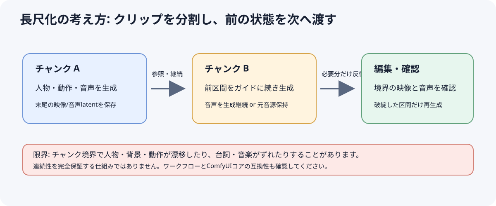
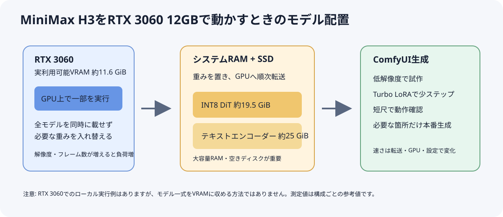
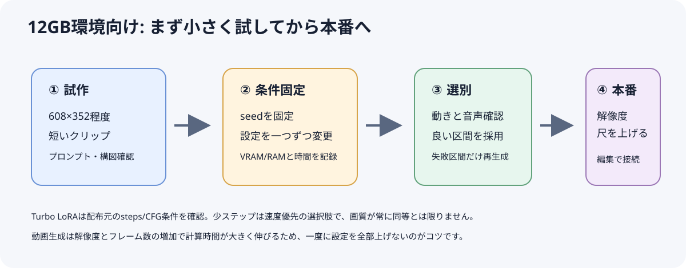

# MiniMax Research Report — 2026-10-17

> 調査実施日: 2026-10-25（Asia/Tokyo）  
> 指定された10月17日付ファイル名を使用しています。調査は10月25日時点で行い、10月17日以後の更新も含めました。Reports内にMiniMaxの前回レポートは見当たらなかったため、今回はマスター指示に対する初回記録として、今後比較できる基準情報も記載します。

## 今週の重要トピック

- **MiniMax H3はComfyUIでローカル実行できるが、RTX 3060 12GBでは大幅なオフロードが前提。** 公式のINT8モデル一式は約42.5GBのディスク容量が必要で、モデル全体をVRAMへ載せる構成ではありません。RTX 3060 12GBでのコミュニティ実測では、短い480pクリップが数分、10秒級は数分〜数十分と、ワークフローや解像度で差が大きく出ています。RAMとストレージの余裕も必要です。
- **長尺生成は「継続Latentを次チャンクへ渡す」方式が進展。** H3 Continuum Plus v3.4はComfyUIコアのH3 masked continuationを使い、映像と生成音声の潜在表現をつないで同一ショットの連続性を狙います。一方、チャンク境界で映像・音声が変化する問題は残り、プロジェクト自身も実験的な機能を安定版の標準経路から外しています。
- **ComfyUI 0.40系列でカメラ情報ノードとH3静止画デコード改善が報告。** CameraAngle/CreateCameraInfoは撮影意図をワークフローで扱いやすくしますが、すべての動画モデルがcamera_infoを解釈するとは限らず、MiniMax H3への幾何学的なカメラ制御を保証する機能とは見なせません。
- **360°/VRはコミュニティ実験の段階。** equirectangular動画の生成やVR180 SBS LoRAの公開例はありますが、解像度・歪み・左右眼の一貫性が実用上の制約です。一般向けVR制作の完成された標準手順とはまだ言えません。

## 新機能・アップデート

### 新規情報

- **ComfyUI 0.40.0付近の更新（10月13日前後）:** CameraAngleとCreateCameraInfoノード、MiniMax H3の単一画像デコード変更がコミュニティのリリース解説で報告されています。単一画像を動画クリップの先頭latentとしてデコードする変更は、静止画出力のバンディング軽減を意図するものです。カメラ情報のモデル側対応は別途確認が必要です。
- **MiniMax公式のH3関連発表:** MiniMax IRは10月12日に「MiniMax H3 IP Edition / Japanese IP」関連ニュースを掲載しています。ただし、ローカル重み・ComfyUIノード・RTX 3060向け新機能の公開を示す情報は確認できませんでした。H3の主要な公開重み発表は8月3日、製品発表は7月31日です。
- **RTX 3060の実行例を増補:** コミュニティがINT8 ConvRot、Turbo LoRA、ComfyUI-MultiGPU/DisTorch2などを組み合わせた実測ワークフローを公開。10月時点の注意点として、Windows 11 + 3060 12GB + 64GB RAMで全PCがフリーズした未解決報告もあり、これは原因確定済みのComfyUI不具合ではありません。

### 更新情報

- **公式モデル・ライセンス:** MiniMax公式H3発表は、ネイティブステレオ音声付き動画、最大15秒・2Kを説明。ComfyUI/Hugging Faceのローカル重みはMiniMax H3 Community Licenseの対象です。モデルの公開は「無制限のオープンソース利用」と同義ではないため、配布元の現行ライセンスと地域条件を確認してください。
- **Hugging FaceのComfy-Org配布:** Comfy-Org/MiniMax-H3にはINT8 ConvRot等のComfyUI向け変換重み、Turbo LoRA、各種VAEなどが整理されています。H3本体やテキストエンコーダーはファイルサイズが大きく、ディスク容量・RAM・オフロード時間がボトルネックになります。
- **公式H3 Max:** 検索で確認できる第三者のモデルリリース一覧には9月2日のH3 Maxが掲載されていますが、10月25日時点でローカル公開重みやComfyUI公式ローカルノードは確認できません。ローカルH3とクラウド/API製品は区別して扱います。

## ComfyUI関連

- **標準ノード:** ComfyUIコアにMiniMaxH3TextToVideo、ImageToVideo、ReferenceToVideo等が含まれ、最新環境ではカスタムノードではなく本体更新で使用できます。公式テンプレートにはT2V、I2V、R2Vがあります。
- **長尺支援:** [H3 Continuum Plus](https://github.com/xmarre/ComfyUI-H3-Continuum-Plus) v3.4はNative Masked continuation、再開可能チャンク、Driving Audio、Video Reference、継続用の映像・音声latent引き継ぎを提供します。Native Masked機能は必要なH3 mask APIを含むComfyUIコアが必要です。異なるショットや長い対話を完全に連続させる保証はありません。
- **カメラ制御:** コミュニティのCamera H3系ノードは、3D上のカメラ軌道やキーフレームを文章プロンプトへ変換します。カメラ埋め込みや幾何学的な制御をモデルに直接与える方式ではなく、H3が角度・タイミングを外す可能性があります。
- **マルチカメラ/人物維持:** ZURAVFX系ワークフローでは元動画を人物・動き・音声の参照に、別の静止画を新しいカメラ角のガイドに使う方法が公開されています。動作原理と成功例はカスタムワークフロー作者の説明であり、公式保証ではありません。
- **簡易実装:** H3 T2V/I2V/R2Vはコア標準ノードから開始できます。追加ノードパックを増やす前に、標準テンプレートが動作するComfyUI版とモデル・VAEの組み合わせを固定するのがトラブル切り分けに有効です。

## 長尺動画関連

- **推奨される基本パターン:** 10〜15秒程度のショットを作り、前チャンクの末尾映像latentを次のチャンクの先頭へ引き継ぐ。必要に応じて人物参照動画・固定参照画像・音声を各チャンクに接続し、問題のある区間だけ再生成します。
- **Continuum Plusの更新:** v3.4では同一ショット継続向けNative Maskedを既定の推奨にしています。24fpsとH3の音声latent整合に沿い、生成音声を継続する構成では39フレーム（約1.625秒）の重なりを使う設定があります。ソース音声を最終トラックとして保つ場合はDriving Audioを使う設計です。
- **品質上の限界:** 長い連結では人物・背景・動作が漂移し、音声が元の台詞や音楽からずれる可能性があります。チャンク間をつなぐ映像参照と、元音声を保持する要件は別々に設定します。連続した長尺作品は、編集ソフトでカットや音声を確認する前提です。
- **監視対象:** ComfyUIコアのH3 denoise mask APIとContinuum側の互換性。2026年8〜9月にはマスク由来の格子状アーティファクトや参照忠実度への懸念がIssue化されており、コア修正後も使うバージョンとワークフローを固定して確認する必要があります。

## 360°・VR関連

- **equirectangular 360°:** Reddit上でH3を使った360°プロンプト・パノラマ映像の試作が共有されています。閲覧者が視点を回す動画としては可能性がありますが、周辺部の継ぎ目、背面の意味整合、カメラ移動時の破綻を評価する第三者ベンチマークは確認できません。
- **VR180 SBS LoRA:** Hugging FaceにMiniMax H3向けVR180 side-by-side LoRA（rank 32、2,500 steps）が公開されています。作者自身が高解像度不足を課題として挙げており、実験用と位置づけるのが妥当です。
- **実用評価:** H3の通常映像を左右眼へ複製するだけでは立体視になりません。VR180は左右眼の視差・人物形状・時間的一貫性を満たす必要があり、H3の短尺出力をそのままVR納品品質と見なさないでください。

## RTX3060 12GBで使える手法

### 1. INT8 ConvRot + オフロード + 低ステップTurbo

**概要:** Comfy-Orgのpruned INT8 ConvRot diffusion modelと適合するQwen3-VLテキストエンコーダー/VAEを使用。重みを全量VRAMへ載せず、ComfyUIのモデルオフロードまたはMultiGPU/DisTorch2系でシステムRAMへ逃がします。Turbo LoRAを使う場合、4-step・CFG 1.0など、配布側が指定する条件を守ります。

**VRAM消費:** RTX 3060の使用可能VRAMは約11.6GiBで、公式ファイルは拡散モデル約19.5GiB、テキストエンコーダー約25.3GiBのため、全量常駐は不可能。公開実測ワークフローは負荷を分割・オフロードして実行しています。

**推論速度:** 一つの公開RTX 3060 12GB測定では、864×480・243フレーム（約10秒）で6分47秒。別の報告では5秒480pが約4.5分というTurbo 8-stepの例がありますが、VAE・ノード・ComfyUI版が異なるため単純比較できません。

**ComfyUI実装難易度:** 高。ComfyUI、Torch/CUDA、ドライバー、モデル量子化、Turbo LoRA、オフロード設定を合わせる必要があります。

**導入難易度:** 高。重み合計が数十GBあり、少なくとも数十GBの空き容量と、実例では64GB級RAMが使われています。軽いRAM環境ではページング・停止・異常終了リスクが高まります。

**実用性評価:** 3060 12GBでローカル生成できる実測報告がある点は有用。ただし低〜中解像度のドラフトを中心に計画し、VRAMだけでなくシステムRAM、SSD容量、生成待ち時間を考慮します。

**注意点:** 4-step蒸留LoRAは推奨CFG条件から外すと失敗や品質低下が起きる可能性があります。INT8/FP8/NVFP4は同じ品質ではありません。NVFP4はRTX 50系Blackwell向けのファイルが含まれるため、RTX 3060での選択肢と混同しないこと。Windowsの全PCフリーズ報告は未解決なので、まず小さな解像度・短い動画で確認し、重要な作業中の環境で一気に長尺を回さないようにします。

### 2. 低解像度で構図検討 → 必要時だけ本解像度へ

**概要:** 608×352など低解像度、短いフレーム数でプロンプトと動きを詰めてから、本番レンダーを実行します。

**VRAM消費:** 空間解像度とフレーム数を下げることで、活性メモリーと転送負荷を抑えます。使用量の絶対値はワークフロー依存です。

**推論速度:** RTX 3060の計測者は608×352を初期案として推奨し、長い・高解像度の生成ほど時間が大きく伸びると報告しています。

**ComfyUI実装難易度:** 低〜中。標準ノードでwidth/heightと動画長を調整し、seedを固定して比較します。

**導入難易度:** 低。標準モデルとテンプレートが動作していることが前提です。

**実用性評価:** 品質を確かめながら試行回数を増やせるため、12GB環境に向くワークフロー改善です。

**注意点:** 低解像度の構図や顔品質が本解像度で完全に維持されるとは限りません。拡大工程で細部を確認します。

### 3. チャンク生成 + 前チャンクlatent/参照の継続

**概要:** クリップを複数セグメントに分け、H3の参照動画・継続mask・latent引き継ぎで人物と動きを保ち、失敗区間だけ再生成します。

**VRAM消費:** 一度に扱うフレーム数を制限できますが、モデル本体・テキストエンコーダーのオフロードは依然必要です。

**推論速度:** クリップ全体のフレーム数と解像度に応じて増加。チャンク分割自体が総計算を減らすわけではありませんが、失敗区間のみの再実行を可能にします。

**ComfyUI実装難易度:** 高。Continuum等の追加ノードと互換コア、Run Storage、音声・映像の境界設定が必要です。

**導入難易度:** 中〜高。ComfyUI更新、追加ノード、参照メディア管理が必要です。

**実用性評価:** 1ショットを長くする用途には有望。複数カットを編集する制作では、各チャンクを独立生成して編集でつなぐ方が安定することもあります。

**注意点:** Native Masked等のコアAPI依存を確認。音声を継続生成するか元音源を保持するかを先に決め、境界で映像・音声双方を試聴・確認します。

## ワークフロー改善情報

1. **まず公式ComfyUIテンプレートで短いテストを実行:** 依存関係を増やす前にT2V/I2V/R2Vの標準ノードとモデルファイルを確認します。
2. **一度に変えるのは1項目:** 解像度、長さ、steps、Turbo LoRA、オフロードを段階的に変え、ログ・実行時間・RAM/VRAMを記録します。
3. **大きなモデルファイルをVRAM容量と混同しない:** 42.5GB級のディスク上の重みはRAM/VRAM間でロード・オフロードされます。空きVRAMだけでなくRAM容量、SSD空き、ページファイル、PCIe帯域も実効速度に影響します。
4. **長尺は小さく区切り、ソース音声を保持:** 各区間を確認し、映像の連続性と音声の連続性を別々に検証します。
5. **カメラ制御はプロンプト補助として評価:** CameraAngle系ノードがcamera_infoを出しても、H3の条件経路がその情報を使用するか確認できるまでは、確定的な幾何制御と見なさない。

## 次週監視項目

- MiniMax公式からのH3 Max詳細、ローカル重み/API提供範囲、H3 IP Editionの生成機能に関する続報。
- ComfyUIの0.40以降でMiniMax H3のCameraAngle/CreateCameraInfoがどのノードに接続され、映像結果を変えるのか。
- RTX 3060 12GBでのWindows安定性、64GB未満RAMでの再現、Turbo 4-step/8-stepの品質比較。
- H3 Continuumや標準mask continuationのコア互換性、音声・映像latent境界の不具合と修正。
- 360°/VR180 LoRAの解像度、左右眼整合、継ぎ目の第三者評価。
- X上のMiniMax公式告知・開発者の実測報告。検索時に検証できる一次投稿が不足しているため、URLを確認できたものだけ次回追加。

## 情報源

### 公式発表

- [MiniMax H3公式発表（2026-07-31）](https://www.minimax.io/blog/minimax-h3) — 最大15秒・2K、ネイティブステレオ音声など。
- [MiniMax Investor Relations ニュース一覧](https://ir.minimax.io/) — 2026-10-12 H3 IP Edition関連発表、8月のH3公開重み告知。

### GitHub / ComfyUI

- [ComfyUI H3公式テンプレート・チュートリアル](https://docs.comfy.org/tutorials/video/minimax/minimax-h3) — T2V/I2V/R2Vとネイティブノード。
- [MiniMax H3 RTX 3060 30-series workflow](https://github.com/Ajay9o9/minimax-h3-30series) — 3060環境・低VRAM設定と実測。
- [ComfyUI-H3-Continuum-Plus](https://github.com/xmarre/ComfyUI-H3-Continuum-Plus) — v3.4の継続latent、音声・映像参照、長尺チャンク。
- [H3 Camera Editor](https://github.com/NyckM/3d-Camera-control-H3-Minimax) — カメラ経路をプロンプトへ変換するコミュニティノード。
- [RTX 3060 Windows freeze issue #16946](https://github.com/Comfy-Org/ComfyUI/issues/16946) — 10月の未解決利用者報告。原因確定ではない。

### Hugging Face

- [Comfy-Org/MiniMax-H3](https://huggingface.co/Comfy-Org/MiniMax-H3) — ComfyUI向けモデル、量子化、VAE、LoRA。
- [MiniMaxAI/MiniMax-H3](https://huggingface.co/MiniMaxAI/MiniMax-H3) — 公式モデルリポジトリ。
- [MiniMax H3 VR180 SBS LoRA](https://huggingface.co/rehan-fal/minimax-h3-vr180-sbs-lora) — rank 32、2,500 stepsの実験LoRA。

### ComfyUI Community / Reddit

- [RTX 3060 12GBでの測定ワークフロー情報](https://github.com/Ajay9o9/runs-on-a-3060/blob/main/video/minimax-h3.md) — GPU、RAM、モデル構成。
- [MiniMax H3向け低VRAM Turbo LoRAのHugging Face discussion](https://huggingface.co/Comfy-Org/MiniMax-H3/discussions/41) — 3060 12GB利用例。
- [MiniMax H3 360°生成のコミュニティ試作](https://www.reddit.com/r/StableDiffusion/comments/1w437jy/a_new_ai_step_immersive_worlds_with_minimax_h3/) — equirectangular動画の実験。
- [2026-10-17 ComfyUI H3ニュースまとめ](https://www.reddit.com/r/comfyui/comments/1x899wr/a_quick_minimax_h3_news_roundup_17th_october_2026/) — ComfyUI 0.41、低VRAM動画解説等の利用者情報。

### X (Twitter)

- 検索で今回の主要なH3更新とRTX 3060測定を裏付ける公開X投稿を確認できませんでした。未検証投稿を引用せず、GitHub、Hugging Face、公式発表、コミュニティ実測ページを情報源としました。

---

**結論:** RTX 3060 12GBでもMiniMax H3をComfyUIで動かした具体的な実測例があります。ただし、INT8等の量子化と大量のRAMへのオフロードが前提で、生成速度は解像度・フレーム数・実装で大きく変わります。まず標準テンプレートを低解像度・短尺で動かし、動作確認後にTurbo LoRA、長尺チャンク、追加ノードを一つずつ導入するのが現実的です。

